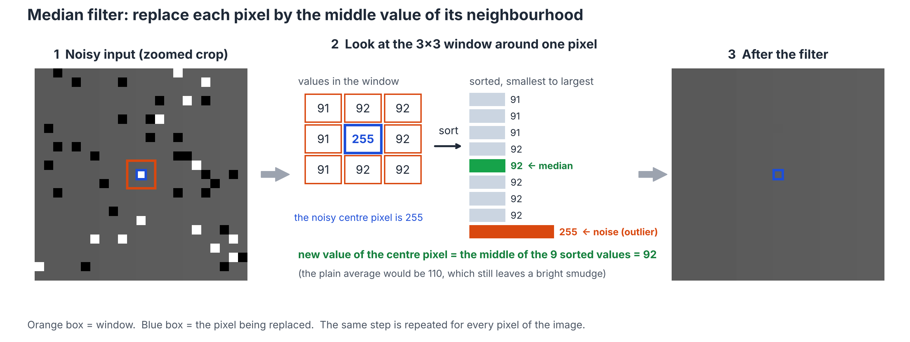
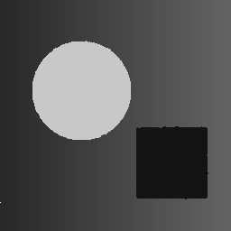
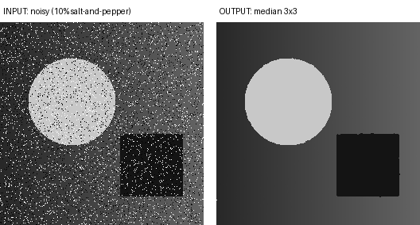
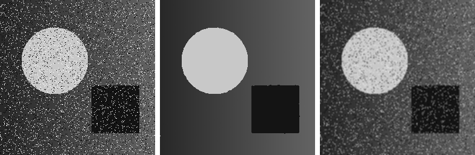

# Median Filter (ImageJ)

A Java program that removes salt-and-pepper noise (random white and black dots) from an image by
applying a **median filter**, using ImageJ to open and show the images. It is our CSC360 Group 4
end-semester project. Its aim is to **understand a filtering algorithm**: what a filter is and how
the median filter works. We studied the chapter on filters in our course textbook, *Digital Image
Processing: An Algorithmic Introduction Using Java*, and then implemented the filter ourselves to
check that we understood it. The terms and definitions below are the textbook's.

---

## What Is Filtering?

1. A filter differs from a point operation because it generally uses **more than one pixel from
   the source image** to compute each new pixel value.
2. Each new pixel value I'(u, v) is calculated as a function of the pixel values within a
   specified **filter region** R of the original image I, fixed relative to the current position
   (u, v).
3. The size of the filter region is the **support** of the filter: how many original pixels
   contribute to each result pixel (for example 3 x 3 or 5 x 5).
4. Filters are **linear** (the result is a weighted sum of the pixels in the region) or
   **nonlinear**. The book's first example is the linear **box filter**, the average of a 3 x 3
   region:

   ```
   I'(u, v) = 1/9 * (sum of the nine values I(u + i, v + j), with i and j from -1 to 1)
   ```

   The **median filter** is nonlinear: its result is not a weighted sum but the centre value of the
   sorted pixels in the region.

---

## How It Works

1. For every pixel position (u, v), take the pixel values in the filter region R, a square of side
   2r + 1 (r = 1 gives 3 x 3, r = 2 gives 5 x 5).
2. Arrange the values as a vector A and **sort** it: a0 <= a1 <= ... <= a2n.
3. The **median** is the centre value a_n. It replaces the pixel:
   **I'(u, v) = median of I(u + i, v + j) over (i, j) in R**.
4. The region has (2r + 1)^2 = 4(r^2 + r) + 1 elements, so the middle index is n = 2(r^2 + r):
   n = 4 for 3 x 3, n = 12 for 5 x 5.
5. Near the image border the region leaves the image. We use **padding** in which the border
   pixels extend beyond the image boundaries; the book calls this simple, with only minor artifacts,
   and often the method of choice.
6. For colour images we use the **scalar (monochromatic) median filter**: each colour channel is
   filtered as its own grayscale image. The book notes this can create colours that were not in the
   original, and that ImageJ uses it as its standard median filter.



The book's own example: the 3 x 3 region with rows `3 7 2`, `1 0 0`, `9 5 8` sorts to
`0 0 1 2 3 5 7 8 9`, and the median is `3`.

**Why it removes noise.** The median is a **rank order statistic**: in a sense the "majority" of
the pixel values decides the result. A single exceptionally high or low value (an **outlier**, such
as a salt-and-pepper pixel) only shifts the result to the next value, so the median is a **robust**
measure, unlike the average. With an odd number of elements it never creates a pixel value that was
not in the original image; with an even number it would average two values, so we use **odd window
sizes only**.

**What to expect.** On a 3 x 3 median filter, isolated dots and thin lines are eliminated, a step
edge stays unchanged, and a corner is rounded off. Compared with the box filter, the median filter
removes the noise dots and keeps the remaining structures largely intact, but it also creates small
spots of flat intensity that affect the sharpness.

---

## Sample Input

```bash
mvn compile exec:java -Dexec.args="src/main/resources/samples/noisy.png 3"
```

`noisy.png` is a 256 x 256 test picture with 10% salt-and-pepper noise. The last argument is the
window size, the size of the filter region (odd, at least 3).


## Sample Output

The filtered picture opens in a new ImageJ window titled **Median filtered (3x3)**.



ImageJ shows both windows, the noisy original and the result:



Left to right below: noisy input, 3 x 3 median filter (nonlinear), 3 x 3 box filter (linear, the
average of the region).



**What this shows:** the median filter removes the noise dots while the disc and the square keep
their edges. The box filter only weakens the dots and blurs the whole picture. A few small specks
remain along the edge of the square, where a window mixes two regions: the corner rounding described
above.

**A small example to check by hand.** A 4 x 4 image with one white (255) and one black (0)
outlier, and the 3 x 3 median output produced by our program:

```
input                  output (median 3x3)
 10  12  11  10         11  11  11  11
 11 255  12  11         11  11  11  11
 10  11   0  12         11  11  11  11
 12  10  11  11         11  11  11  11
```

For the pixel in row 2, column 2 (the 255), the filter region R holds `10 12 11 / 11 255 12 /
10 11 0`. Sorted, the vector A is `0 10 10 11 11 11 12 12 255`, and the centre value a_4 is `11`.
Both outliers end up at the two ends of A, so neither can be the median. The corner pixel has no
neighbours above or to the left, so padding repeats the border pixels (region `10 10 12 / 10 10 12 /
11 11 255`); its sorted vector is `10 10 10 10 11 11 12 12 255`, and the median is again `11`.

---

## What We Learned

We read first, worked small examples by hand, and wrote code only when we could predict its output.

| Topic | What we did | What we learned |
|---|---|---|
| Filter basics | Read what a filter is | A filter uses a set of source pixels (the filter region R), not a single pixel. The support is the size of R. |
| The median | Worked the book's example by hand (`3 7 2 / 1 0 0 / 9 5 8` gives 3), then our own region `50 52 51 / 49 255 53 / 50 51 52` | The median is the centre value a_n of the sorted vector A. Sorted, our region is `49 50 50 51 51 52 52 53 255`, so the noisy 255 becomes 51. The average is about 74 (663 / 9); we first wrote 67, recomputed the sum, and corrected it. |
| Borders | Compared the border methods | The book's own sample code leaves the border unfiltered, which it says usually gives unacceptable results. We chose padding with the border pixels extended and tested that a noisy pixel in a corner is removed. |
| Window sizes and structures | Predicted, then tested what a median does | An isolated dot vanishes and a straight edge stays sharp; a larger window removes a thicker blotch (structures smaller than half the filter size are eliminated). One early blotch test failed because our hand-worked expectation was wrong, not the filter; we fixed the test. Even window sizes are rejected and tested. |
| Colour | Read how colour is filtered | Filtering each channel separately can produce new colours. The vector median filter avoids this; we did not implement it. |
| ImageJ | Connected the filter to ImageJ images | ImageJ images can be 8-bit, 16-bit, RGB or float. We support the first three and reject float images with a clear error message. |

**Still open:** the weighted median filter, the vector median filter, and a circular filter region.
The book implements the median filter as an ImageJ plugin (`PlugInFilter`); ours is a standalone
program that uses ImageJ.

---

## Project Structure

| File | Purpose |
|---|---|
| `Median.java` | Sorts the values of a filter region and returns the centre value a_n |
| `MedianFilter.java` | The median filter for a grayscale image: I'(u, v) is the median of the region R |
| `ColorFilter.java` | Scalar median filter for colour images (red, green, blue separately) |
| `PixelGrid.java` | Pixel access with padding at the image border |
| `FilterOptions.java` | Checks the window size (odd, at least 3) and computes the radius r |
| `ImageAdapter.java` | Converts between ImageJ images and plain `int[][]` arrays |
| `MedianFilterApp.java` | The `main` method: opens an image, filters it, shows both |
| `Experiments.java` | Adds seeded salt-and-pepper noise to a test picture and filters it |
| `package-info.java` | Javadoc for the package |

The code follows Maven's standard layout: `src/main/java/medianfilter`, `src/main/resources/samples`
(test images), `src/test/java/medianfilter` (42 JUnit 5 tests), `pom.xml`. The filter classes work
on plain arrays, so only `ImageAdapter` and `MedianFilterApp` depend on ImageJ.

---

## How to Run

```bash
mvn test                                        # 42 JUnit tests
mvn compile exec:java -Dexec.args="path/to/image.png 3"
mvn javadoc:javadoc                             # open target/site/apidocs/index.html
```

Requirements: JDK 11 or newer and Apache Maven 3.8 or newer.

---

## Team Contributions

| Module | Owner |
|---|---|
| Setup: `pom.xml`, `.gitignore`, `package-info`, `ImageAdapter`, `MedianFilterApp`, `Experiments`, sample images | Dhyan |
| Pixel access and window size rules (`PixelGrid`, `FilterOptions`) | Shashwat |
| The algorithm (`Median`, `MedianFilter`, `ColorFilter`) | Dev |
| Tests for `Median`, `PixelGrid`, `FilterOptions`, `MedianFilter`, `ColorFilter` | Krishna |
| Tests for `Experiments`, final README | Dev |

Each module was developed on its own Git branch and merged into `main` via pull request, in this
order, because each part depends on the previous one: Setup, Pixel access, Algorithm, ImageJ
application, Tests.
